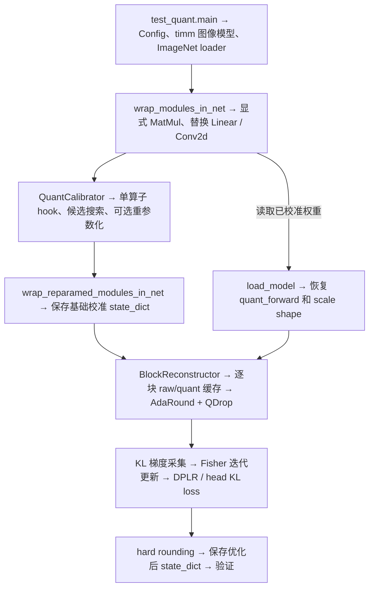

# FIMA-Q 适配 VideoMAE 的 W4A4 PTQ 分析与实施计划

## 结论与范围

以当前已验证的 VideoMAE ViT-B/16、UCF101 split 1 微调检查点为起点。建议在量化副本中增加一个薄的 VideoMAE Attention 适配器，复用 FIMA-Q 的非对称 Linear、双输入 MatMul、等价重参数化、AdaRound、QDrop 和 Fisher/DPLR 重建。原 `Block.forward` 已能驱动这些子模块，直接注册为重建单元即可。Tubelet 投影是 `Conv3d`，需要单独移植 FIMA-Q 的卷积校准与重建支持。

最终主研究配置将 Tubelet 投影、Transformer 块内 Linear 和分类头设为 W4A4，两次 Attention MatMul 设为 A4×A4。首层另设真实执行 A8 Q/DQ 的 W4A8 对照，以及参考实现的 W4、浮点输入对照。FIMA-Q `4bit/best.py` 配置的 `qconv_a_bit=8` 会触发源码的激活旁路。各配置分别保存基础校准和 DPLR 重建结果，并使用同一个 VideoMAE 视频级评估协议。交付目标是 fake quantization 精度 Baseline。 [FIMA-Q 卷积路径](../FIMA-Q-main/quant_layers/conv.py#L55) · [实施后运行说明](VIDEO_PTQ_RUNBOOK.md)

## 1. VideoMAE 结构与浮点参考

### 1.1 模型与张量形状

分类入口是 [`modeling_finetune.py` 的 `vit_base_patch16_224`](../modeling_finetune.py#L298)，构造 12 层 `VisionTransformer`，宽度 768、12 个注意力头、每头 64、MLP 扩张比 4，LayerNorm 的 `eps=1e-6`。本地命令送入 16 帧、`tubelet_size=2`、分辨率 224。`B` 是同批视角数，每个视角是一段独立输入。模型按时间、高、宽顺序 flatten，宽度轴变化最快，得到 `N=8×14×14=1,568`。时空位置信息来自输入结构和原有位置编码。分类路径使用全部 token，采用全局注意力及平均池化。预训练的 masking 和 decoder 不在这条路径中。 [模型构造和 forward](../modeling_finetune.py#L173) · [VideoMAE 论文](https://papers.neurips.cc/paper_files/paper/2022/hash/416f9cb3276121c42eebb86352a4354a-Abstract-Conference.html)

| 位置 | 现有实现 | 本地配置下的输出形状 |
|---|---|---|
| 模型输入 | 解码后由 `ClipToTensor` 转成 `C,T,H,W`，loader 在轴 0 堆叠 | `[B,3,16,224,224]` |
| `patch_embed.proj` | `Conv3d(3,768)`，kernel 和 stride 均为 `(2,16,16)`，有 bias | `[B,768,8,14,14]` |
| `PatchEmbed`、`pos_embed` | `.flatten(2).transpose(1,2)`，加 `[1,1568,768]` 的正弦余弦位置编码。当前模型无额外 class token | `[B,1568,768]` |
| `blocks.i.norm1`、`norm2` | token 末轴上的 pre-LayerNorm。两个分支各做一次 residual add，原实现支持可选 `gamma_1/gamma_2` 与 DropPath | `[B,1568,768]` |
| `blocks.i.attn.qkv` | `nn.Linear(768,2304,bias=False)` 持有权重，forward 直接调用 `F.linear`。有 Q/V bias 时，拼为 `[q_bias, 0, v_bias]` | `[B,1568,2304]`，重排成 `[3,B,12,1568,64]` |
| Attention logits | 先算 `q * scale`，再与 `k.transpose(-2,-1)` 相乘 | `[B,12,1568,1568]` |
| Softmax、`attn_drop` | 沿最后一轴 Softmax，随后执行原 dropout | `[B,12,1568,1568]` |
| Attention 加权求和、`attn.proj` | 概率乘 `v`，再 `.transpose(1,2).reshape(B,N,-1)` 并过 Linear 和 `proj_drop` | `[B,12,1568,64]` → `[B,1568,768]` |
| `mlp.fc1`、GELU、`mlp.fc2` | `768→3072→768`，GELU 位于两层 Linear 之间，dropout 在第二层之后 | `[B,1568,3072]` → `[B,1568,768]` |
| `norm` / `fc_norm`、`head` | 默认 `norm=Identity`，在 token 轴求均值，经 `fc_norm`、`fc_dropout`、`Linear(768,101)` | `[B,768]` → `[B,101]` |

`use_mean_pooling=False` 时执行最后的 LayerNorm 并取索引 0 的现有 token。适配器应保留这一分支和原来的 `reshape(...,-1)`，并从模块读取头数、`scale` 和实际权重形状。 [MLP](../modeling_finetune.py#L35) · [Attention](../modeling_finetune.py#L55) · [Block](../modeling_finetune.py#L102) · [PatchEmbed](../modeling_finetune.py#L134) · [分类 forward](../modeling_finetune.py#L261)

### 1.2 权重加载与现有评估

- `run_class_finetuning.py` 用本地注册的模型和 `all_frames=num_frames*num_segments` 构造浮点网络。本地命令指定 `--no_auto_resume` 和 `--model_key module`，从 `pretrained/VideoMAE_ViT-B_16x1_224_UCF101.pth` 加载。现有加载逻辑可处理容器键、`backbone.` / `encoder.` 前缀、分类维度不匹配和有 `pos_embed` 时的空间插值。本检查点的 `module` 含 `patch_embed`、12 层 `blocks`、`fc_norm` 和 101 类 `head`，无 `pos_embed` 键，模型按构造生成固定表。检查日志显示权重文件中的张量以 `float16` 存储，加载到默认构造的浮点参数中。 [构造与加载](../run_class_finetuning.py#L303) · [加载诊断](../utils.py#L293) · [检查点检查日志](../out_log/ucf101_checkpoint_inspect.log)
- 已验证的 GPU 浮点运行复用 `build_dataset(test_mode=True)`、分布式测试 loader、`final_test`、`merge`，其中 `final_test` 在 `model.eval()` 下使用 CUDA autocast。本文的浮点参考指该无量化模型和已有评估结果。后续 raw 数值对照另加关闭 autocast 的 FP32 用例。测试先按 `sampling_rate=4` 对整段视频取帧，短视频补最后一帧，按短边 224 双线性 resize，再按 5 个时间起点和 3 个长边方向空间起点切出 `16×224×224` 的视角。输入除以 255，按 RGB ImageNet 均值和标准差归一化。 [UCF101 Dataset 分支](../datasets.py#L119) · [视角裁剪](../kinetics.py#L124) · [帧解码](../kinetics.py#L222) · [预处理](../kinetics.py#L62) · [ClipToTensor](../volume_transforms.py#L29)
- `final_test` 输出每个视角的 logits、视频 ID、标签、时间片段号和空间裁剪号。`merge` 对每个视角先做 Softmax，按视角位置去重，再对概率取均值计算视频级 Top-1/Top-5。本地日志记录 **91.2503% / 98.5461%**，覆盖 **3,783 个视频、56,745 个唯一视角**，两卡分布式额外产生一条 padding 记录。现有脚本末行的 `test videos` 计数来自视角 Dataset 的长度。 [运行命令](../RUN_COMMANDS.md#L193) · [评估入口](../run_class_finetuning.py#L475) · [final_test](../engine_for_finetuning.py#L180) · [merge](../engine_for_finetuning.py#L233) · [结果核对日志](../out_log/videomae_vitb_ucf101_split1_5x3_verify.log)

## 2. FIMA-Q 本地调用关系与 W4A4 实现

代码依据是工作区 `FIMA-Q-main/`。论文给出逐块 Fisher 近似与 KL 的关系。公开分类实验设置描述的 rank 为 15，本地 `4bit/best.py` 的默认值为 5。这里以本地默认值复现首个 Baseline，并在记录中区分代码配置与论文配置。 [CVPR 论文页面](https://openaccess.thecvf.com/content/CVPR2025/html/Wu_FIMA-Q_Post-Training_Quantization_for_Vision_Transformers_by_Fisher_Information_Matrix_CVPR_2025_paper.html) · [论文 §3–4](https://arxiv.org/html/2506.11543v1) · [本地 4-bit 配置](../FIMA-Q-main/configs/4bit/best.py)

上述基础校准、读取基础校准检查点、执行重建及直接加载优化检查点由 `test_quant.py` 控制。原入口对有标签的图像 loader 调用 `validate` 只是额外统计，VideoMAE 校准和重建入口无需这条验证路径。 [入口及分支](../FIMA-Q-main/test_quant.py#L152) · [保存与加载](../FIMA-Q-main/test_quant.py#L112)

### 2.1 实例化的量化器和粒度

`quantizers/uniform.py::UniformQuantizer` 是默认的权重和激活基础。非对称 W4/A4 使用 `q=clamp(round(x/s)+round(z),0,15)`，输出浮点 `(q-round(z))*s`。对称 4-bit 则是 `[-8,7]`，用于代码里的对称配置。`scale/zero_point` 由算子按粒度实例化，训练模式用 STE 对连续量做舍入的梯度近似。`Log2Quantizer` 存在于仓库，默认替换链路对 Softmax 后概率仍使用非对称均匀量化。 [UniformQuantizer](../FIMA-Q-main/quantizers/uniform.py#L7) · [STE](../FIMA-Q-main/quantizers/_ste.py) · [Log2Quantizer](../FIMA-Q-main/quantizers/logarithm.py#L8) · [替换逻辑](../FIMA-Q-main/utils/wrap_net.py#L55)

| 实际类 | 4-bit 配置下的初始化和粒度 | 重建期行为 |
|---|---|---|
| `AsymmetricallyBatchingQuantLinear` | 权重是输出通道粒度的非对称 `scale/zp`，形状 `[n_V,C_out/n_V,1]`。QKV 用 `n_V=3`，其余用 1。激活从单 `scale/zp` 开始，3D 输入的 `scale` 校准后复制成 `[1,N,1]`，`zp` 保持标量。head 的 2D 输入保持标量 `scale/zp` | 优化 `alpha` 和 A scale。3D 输入的各 token scale 可从同值初始化分化 |
| `AsymmetricallyChannelWiseBatchingQuantLinear` | 新鲜校准时，wrapper 对等位宽的 `qkv`、`fc1` 和 Swin `reduction` 选此类。先为输入通道搜索非对称 `scale/zp`，用前置 Norm 折叠通道仿射，再由普通 Linear 搜索并完成校准 | 折叠结束后转为普通 `AsymmetricallyBatchingQuantLinear`，前置 Norm 的折叠结果进入量化副本 |
| `AsymmetricallyBatchingQuantMatMul` | QK 和 AV 各有独立的 A/B 量化器，两侧均非对称 A4。默认按头搜索 `scale/zp`（`[1,h,1,1]`）。然后复制 A 的行轴 scale 和 B 的列轴 scale。QK 为 `[1,h,N,1]` / `[1,h,1,N]`，AV 为 `[1,h,N,1]` / `[1,h,1,d_h]`，AV 右侧沿每头输出通道，两个 `zp` 均保持按头 | 学习扩展后的两个 scale。AV 的概率操作数按 query 行共享该行各 key 的 scale |
| `AsymmetricallyBatchingQuantConv2d` | 权重 W4，非对称、按输出通道。代码构造对称逐张量 A8 量化器并按 absmax 初始化 scale，但 `quant_input` 在 `n_bits >= 8` 时直接传递浮点输入 | 原 `PatchEmbed` 被选作一个重建单元。A8 scale 可进入优化器，但旁路令其不参与前向 |

Linear 的常规激活和权重分别从分位点生成范围。默认使用 `0.9/1.0` 上侧分位点及互补下侧分位点，4 bit、`eq_n=128` 下为每组 8 个尺度、16 个零点组合。先最小化张量自身的 Q/DQ MSE，再在原算子输出上交替搜索权重、激活参数。MatMul 从 `0.99/0.99999` 上侧分位点及互补下侧生成候选，用算子输出误差先选两侧，再交替固定上界或下界做坐标搜索。默认误差为 MSE，`search_round=3`。`token_channel_wise=True` 带来的 scale 扩展发生在这些搜索完成后，独立的逐位置 scale 来自重建优化。 [Linear 搜索和扩展](../FIMA-Q-main/quant_layers/linear.py#L449) · [Linear 通道重参数化](../FIMA-Q-main/quant_layers/linear.py#L527) · [MatMul 搜索和扩展](../FIMA-Q-main/quant_layers/matmul.py#L202) · [Conv2d 校准](../FIMA-Q-main/quant_layers/conv.py#L273)

### 2.2 基础 PTQ 校准

1. `wrap_modules_in_net` 先用 `MethodType` 为 timm ViT/Swin Attention 显式挂上 `matmul1/2`，再遍历替换 `nn.Linear`、`nn.Conv2d` 和 `MatMul`。替换单元初始化为 `raw`，复制原权重和 bias。`MinMaxQuant*` 是这些类的基类，实际 4-bit 入口用表中的非对称子类。 [wrap_net.py](../FIMA-Q-main/utils/wrap_net.py#L55)
2. FIMA-Q 的 `ViTImageNetLoaderGenerator` 用 timm 的图像预处理，按种子从训练集取样并默认预加载，顺序执行 loader。`QuantCalibrator` 每次对一个待校准算子注册 hook、重放校准集、缓存 CPU 输入和输出，双输入 MatMul 记录两侧。对收集到的张量拼接，再在 `no_grad` 下做候选搜索。`batching_quant_calib` 中初始额外计算的一份 `raw_pred_softmaxs` 在该函数内没有被使用。算子校准目标是输出误差，Fisher 的教师概率来自下一阶段。 [图像采样](../FIMA-Q-main/utils/datasets.py#L62) · [基础校准](../FIMA-Q-main/utils/calibrator.py#L37)
3. 折叠只在量化副本执行。设旧 Linear 为 `Wx+c`，折叠将上游 Norm 输出改为 `x'=x/r-b`，再用 `W'=W·diag(r)`、`c'=c+W'b` 保持原实数映射。源码同步变换缓存输入，再运行普通 Linear 校准。全部算子完成后切到 `quant_forward`，用 `wrap_reparamed_modules_in_net` 固化子类及扩展 scale 形状，保存基础校准检查点。默认搜索用 128 个样本，原校准 batch 32。 [折叠实现](../FIMA-Q-main/quant_layers/linear.py#L571) · [固化与主流程](../FIMA-Q-main/utils/wrap_net.py#L154) · [校准分支](../FIMA-Q-main/test_quant.py#L228)

### 2.3 FIMA-Q 块级重建

- `BlockReconstructor` 按模型遍历顺序选 `PatchEmbed`、ViT `Block`、Swin `SwinTransformerBlock`、`PatchMerging` 和 `head`。构造函数为前四类换上架构专用 forward，保留 `perturb` 分支供源码内部使用。当前默认路径把该开关初始化为 `False`，重建循环未启用它。VideoMAE 可直接用原 Block 的输入和输出 hook。 [单元选择和 forward](../FIMA-Q-main/utils/block_recon.py#L17)
- 逐块重放同一批次的输入。全网 raw pass 缓存当前块的 FP 输入/输出并首次缓存温度缩放的教师概率。需要 quant input 时，用已经重建的前缀量化，其余块 raw，再缓存输入并恢复 raw。每次开始优化把当前块切成 `quant_forward`。因此默认 Fisher 刷新时，端到端 KL 使用当前块的量化状态，其他块为 raw。prefix-quant 输入缓存用于块优化的 QDrop 路径。块缓存先收集在 CPU，`keep_gpu=True` 时再把当前块的 raw input、raw output、quant input 等搬到设备。 [块缓存与模式](../FIMA-Q-main/utils/block_recon.py#L163) · [优化循环](../FIMA-Q-main/utils/block_recon.py#L277)
- 对有权重的量化算子用 `AdaRoundQuantizer` 包裹原权重量化参数。每个权重对应一个 `alpha`，由原始舍入小数部分初始化。优化对象为 `alpha`（Adam 默认学习率 `1e-3`）和激活 scale（Adam，`4e-5`，余弦退火），未把主干浮点权重、bias 或 zero-point 加入优化器。默认每块 20,000 步，每次从缓存随机取至多 32 个样本。重建损失加权 `0.01` 的舍入正则，前 20% 不加正则，其后指数 `b` 由 20 线性衰减至 2。默认 `optim_size=1024`、`temp=20`、`k=5`、`p1=p2=1`、`dis_mode=q`。QDrop 的 `0.5` 同时用于逐元素混合 quant/raw 块输入，以及在激活量化器内选择保留 Q/DQ 或绕过。`head` 用原 logits 上的 `kl_div` 重建分支。 [AdaRound](../FIMA-Q-main/quantizers/adaround.py#L19) · [重建参数和 QDrop](../FIMA-Q-main/utils/block_recon.py#L277) · [正则与线性衰减](../FIMA-Q-main/utils/block_recon.py#L473) · [4-bit 配置](../FIMA-Q-main/configs/4bit/best.py)

**Fisher/DPLR 的代码等价描述。** `new_fisher_ro` 用 `KL(teacher_probs || student_probs)`，其中 logits 除以 `temp`，`F.kl_div` 用 `batchmean`。取当前块输出的梯度和量化输出。对样本先取梯度绝对值和输出差绝对值、再在样本维求均值。每次刷新追加一对向量到 `G=raw_grad` 和 `D=delta_out`，均为 `[r,d]`，`d` 是单个样本的块输出元素数。`inverse_B=inv(D @ D.T)` 只有 `[r,r]`。对每个重建样本 `e=abs(y_q-y_fp).flatten()`，计算 `a=e @ abs(G).T`。低秩项是样本上的 `a @ inverse_B @ a.T` 均值，对角项是 `e² * mean_r(abs(G))` 的均值。代码分别除以每次刷新后首次计算的两项值，再乘 `p1/p2` 相加。默认 `q` 每 `floor(iters/k)` 步刷新一次，`qf` 在前 `k` 步刷新。`fisher_brecq` 是独立分支，用按样本采集的梯度平方加权，不承担 DPLR 的实现。VideoMAE 的 `d=1,568×768=1,204,224`，保持同样 flatten 规则即可，避免显式构建 `d×d` 矩阵。 [梯度与低秩统计](../FIMA-Q-main/utils/block_recon.py#L225) · [DPLR 和对照损失](../FIMA-Q-main/utils/block_recon.py#L423)

**检查点。** 源码完成每块后关 soft rounding 和 QDrop。所有块完成后调用 `get_hard_value`，把硬舍入网格值写入量化模型权重，再删掉 `alpha`、设权重量化器为 `nearest`。`get_hard_value` 只执行 `floor(w/s)+(alpha>=0)` 再乘 scale，码值的裁剪仍由后续 `quant_forward` 完成。两阶段均只保存 `state_dict`，加载时用配置重建量化图，恢复动态 scale 尺寸、`calibrated/inited/mode`，并用 `strict=False` 加载。量化副本在优化后以 quant 模式推理。优化检查点中的浮点网格权重不再是构造 FP 教师的来源。 [重建收尾](../FIMA-Q-main/utils/block_recon.py#L353) · [硬舍入函数](../FIMA-Q-main/quantizers/adaround.py#L71) · [序列化](../FIMA-Q-main/test_quant.py#L112)

### 2.4 架构和环境绑定

| 本地 FIMA-Q 绑定 | VideoMAE 的影响 |
|---|---|
| `test_quant.py` 仅列出 timm ViT/DeiT/Swin，图像数据来自 `ImageFolder` 和 timm transforms，模型加载可回退到 `pretrained=True` | 独立视频入口须读取本地 VideoMAE 微调权重，并复用视频特定的数据与评估协议 |
| ViT/DeiT Attention 改写依赖 timm 类型、`q_norm/k_norm`，在 QK 矩阵乘之后乘 `scale` | VideoMAE 使用本地类型、拼接 Q/V bias，QK 之前缩放 Q。位置交换会改变被量化的操作数 |
| Swin 走 `WindowAttention`、相对位置偏置、mask、二维窗口切分/反切分、二维 `PatchMerging` | VideoMAE 使用全局时空注意力。Video Swin 的三维窗口、mask 和相对位置偏置应由未来独立 adapter 保留 |
| timm `PatchEmbed` forward 的输入为 BCHW，并依赖 `flatten` 和 `norm`。ViT Block 用 `drop_path1/2`、`ls1/2`。重建头按名称识别 | VideoMAE stem 是 BCTHW，Block 用自身 `drop_path` 及可选 `gamma_1/2`。通过明确的有序单元列表指定 stem、Block、head |
| wrapper 仅替换 `Conv2d`，calibrator 和重建器也用 `MinMaxQuantConv2d` 分派；加载器对名为 `reduction` 的 Linear 补 bias | 需新增 `Conv3d` 注册及按角色的 bias 恢复规则，覆盖原模型的实际算子 |
| 参考 README 指定 PyTorch 2.2.2 / timm 0.9.2，FIMA-Q 导入 `timm.layers.patch_embed` 和裸 `utils.*`、`quant_layers.*` | 现有 VideoMAE 环境可见 PyTorch 1.9.1+cu111 / timm 0.4.12 / NumPy 1.23.5，根目录有 `utils.py`。独立包使用相对导入并移除通用核心对 timm 类型的依赖。若建立新环境，先验证旧评估的 `np.float`、timm 注册和 PyTorch 行为 |

[timm Attention 和替换](../FIMA-Q-main/utils/wrap_net.py#L19) · [timm 重建分派](../FIMA-Q-main/utils/block_recon.py#L80) · [FIMA-Q 环境](../FIMA-Q-main/README.md#L7) · [VideoMAE 环境](../INSTALL.md#L7)

## 3. VideoMAE 模块映射与量化覆盖

表中的浮点指继承原执行环境的浮点算子。在 CUDA 评估中由原 autocast 决定执行 dtype。对算子输入进行 A4 Q/DQ 后，该算子的输出可保持浮点，直至下一个量化边界。`W4A4` 表示权重和输入激活的模拟位宽。MatMul 没有持久权重，表中用 `A4×A4` 描述。

| VideoMAE 模块或算子 | FIMA-Q 组件与处理方式 | 主配置 |
|---|---|---|
| `patch_embed.proj` | 新增 `QuantConv3d`，沿输出通道复用权重量化与候选搜索思路，保留 3D 投影 | W4A4，首层另可设为 W4A8 或参考的 W4、浮点输入 |
| `patch_embed` 的 flatten/transpose、位置编码与相加 | 原 VideoMAE 实现，卷积结果仍按原布局展平 | 浮点 |
| `blocks.*.norm1` / `norm2` | 原 LayerNorm。量化副本上的 affine 可被 FIMA-Q 重参数化折叠 | 浮点 |
| `blocks.*.attn.qkv` | Attention adapter 将原拼接 bias 交给常规量化 Linear，`n_V=3`，前置 `norm1` 可折叠 | W4A4，bias 浮点 |
| `q * scale`、QKV split / transpose | 保留原顺序与形状 | 浮点 |
| `Q_scaled @ K^T` | `AsymmetricallyBatchingQuantMatMul`，在 adapter 中挂为 `matmul1` | A4×A4 |
| Softmax / `attn_drop` | 原函数。Softmax 输出进入 AV 左操作数时做 A4 | 浮点 |
| `P @ V` | 独立的 `AsymmetricallyBatchingQuantMatMul`，挂为 `matmul2` | A4×A4 |
| `blocks.*.attn.proj` | 常规非对称 FIMA-Q Linear | W4A4，bias 浮点 |
| `blocks.*.mlp.fc1` / `fc2` | 常规非对称 FIMA-Q Linear，`fc1` 由 `norm2` 折叠；`fc2` 的输入是 GELU 输出 | W4A4，bias 浮点 |
| GELU、残差、LayerScale、DropPath、Dropout | 原 `Mlp` 和 `Block.forward` 按原顺序执行 | 浮点 |
| `norm`、池化、`fc_norm`、`fc_dropout` | 原分类聚合路径 | 浮点 |
| `head` | 常规非对称 FIMA-Q Linear，以 2D 激活校准并独立做 KL 重建 | W4A4，bias 和 logits 浮点 |

ViT-B 的目标覆盖为 **49 个 Linear、24 个双输入 MatMul、1 个 Conv3d**。接入前可先交付 Conv3d 浮点的调试阶段结果，报告该阶段的首层精度。主配置完成后，分别比较 W4A4 基础校准与 W4A4+DPLR，以及首层 W4A8 的相同两阶段结果。用 Float→Q/DQ→`F.linear` / `F.conv3d` / `@` 实现模拟，并用 profiler 核对实际浮点算子。真实 INT4 推理还需压缩存储、量化 kernel、zero-point 补偿、累加和支持目标粒度的部署后端。现阶段只记录精度和 fake-quant 的实测资源开销。

## 4. 建议的适配方案

### 4.1 Attention、Block 与 Conv3d

1. **Attention 需要专门适配。** 建议仅在加载好的 VideoMAE 副本中，用 `VideoMAEQuantAttention` 包住原有计算。将 `[q_bias,0,v_bias]` 一次性复制成副本 `qkv.bias`，无 Q/V bias 的模型从 `bias=None` 开始。让 `qkv(x)` 在 raw 路径执行同一次带 bias 的 `F.linear`，并进入 Linears 的算子级 hook 与候选搜索。折叠后由 `qkv.bias` 保存补偿，K 段此时可含等价补偿。后续量化检查点按副本的 bias 拓扑加载。沿用原来的 Q 前置缩放、重排、Softmax、dropout 和输出投影。仅替换原 `qkv` 权重容器会漏掉实际 Linear 执行，直接套用 timm 的 Attention forward 会改变输入缩放和依赖关系。 [VideoMAE QKV](../modeling_finetune.py#L67) · [FIMA-Q Linear forward](../FIMA-Q-main/quant_layers/linear.py#L26)
2. **复用原 `Block`。** 在 adapter 提供按执行顺序排列的重建单元 `[patch_embed（启用时）, *blocks, head]`。`norm1→attn.qkv` 与 `norm2→mlp.fc1` 由 adapter 显式声明，折叠前确认 Norm 输出只供指定的 Linear 消费。adapter 只负责算子布局和替换，block input/output hooks、重建模式切换、量化状态、损失与优化器由通用层负责。保持 `eval()` 以禁用模型 dropout/DropPath，QDrop 由量化器的独立开关控制。
3. **实现 Conv3d 参考路径。** 沿每个 3D 卷积输出通道将权重逻辑展平为 `[C_out,C_in/groups×k_t×k_h×k_w]` 搜索/初始化。AdaRound 在原 5D 核上按相同的输出通道粒度广播并建立 `alpha`。`F.conv3d` 保留原 bias、stride、padding、dilation、groups。将 Conv2d 的空间误差归约扩展为 `(T',H',W')`，保留按输出通道的候选排名。A4 搜索激活 scale，A8 对照用 absmax 初始化并实际执行 Q/DQ，参考配置则执行激活旁路。保留独立 `PatchEmbed` 重建单元以沿用 stem→首块的量化输入依赖。用 `k_t=1,T=1` 的等价卷积用例检查候选和输出后，再验证实际 `(2,16,16)` 投影。 [FIMA-Q Conv2d 权重候选](../FIMA-Q-main/quant_layers/conv.py#L236) · [Conv2d 激活 scale](../FIMA-Q-main/quant_layers/conv.py#L167) · [VideoMAE Conv3d](../modeling_finetune.py#L134)

### 4.2 时空 token 与通用接口

- 保留完整的 `[B,N,C]` token 序列及原有时空顺序。基础校准和块优化都以完整视频视角为样本。DPLR 对每个块输出直接从 `[B,N,C]` 展平至 `[B,N×C]`，保留所有坐标和批维。继续使用 FIMA-Q 既有的逐 token 或按头 scale 扩展，以统一的 `token_channel_wise=True` 配置验证形状和学习。token 几何只用于形状校验、缓存估算与 checkpoint 兼容检查。保持同一份 16 帧、`tubelet_size=2`、224 分辨率的几何配置用于重放和测试。长度变化需要重新校准其 scale。
- 通用层接受 `QuantPolicy`、有序 `QuantTarget` 与 `ReconstructionUnit`。前者设置每种算子角色的位宽、量化粒度及仿射策略。目标记录模块、替换方式、Conv/Linear/MatMul 类型和可选前置 Norm。重建单元记录模块、输入/输出采集方式、顺序及是否使用 head KL。`BackboneAdapter` 从模型和输入约定产生这些信息，并暴露 logits 提取。`CalibrationSource` 提供有稳定 ID、可重放的 clip 批次。量化数学、缓存、损失和序列化包只消费这些约定。后续 TimeSformer 可在自己的 adapter 注册原有时间/空间 Attention 单元，Video Swin 注册窗口 Attention、Patch Merging 和相应成组形状。
- 把 FIMA-Q 的量化器、STE、Linear/MatMul Q/DQ、AdaRound 和损失公式迁入独立命名空间，保留来源和许可。候选搜索、仿射折叠、calibrator、reconstructor 函数在兼容化后复用。需要实现显式设备、可重放缓存、基于算子角色的发现和模式切换、Conv3d 分派及严格检查点恢复。量化期间禁用模型的训练用 activation checkpoint 分支，量化状态与 cache 由专用入口管理，原 FP 命令继续使用已验证参数。

### 4.3 无标签校准与同协议评估

| 环节 | 方案 |
|---|---|
| 校准和重建片段 | 只从 `annotations/ucf101_split1/train.csv` 的路径列按种子采样。实查 train 有 9,537 条，test 有 3,783 条，两者无交集，`val.csv` 与 test 对应同一批视频。生成可重放 `(video,segment,crop)` 清单，在训练视频上使用当前 test-mode 的解码、抽帧、resize、裁剪和归一化。第一版每个选中视频固定一个视角，视角索引用种子在 15 个候选中分布抽取。向 `VideoClsDataset` 提供所需占位字段，量化入口只读取 clip/ID。保留 5×3 采样设置，再按清单选择视角，避免现有 Dataset 的 `segments-1` 和 `crops-1` 在取 1 时为零。 |
| 样本及教师对齐 | 以 128/1024 个 clip 为基础校准/重建规模，采用同一固定随机排列的前缀和稳定 batch 序号。逐次核验实际 ID、视角和形状一致，对解码失败引发的随机换样采用 fail-fast 或预先生成确定性的替补清单并重新校验两阶段。先验收重参数化后量化副本的全 raw logits 与原浮点 logits 的等价性。沿用上游，从该副本的全 raw pass 缓存教师概率和块输出目标。Fisher 与 head KL 使用各自对应的教师预测，真实标签只用于最终评估。 |
| 量化评估 | 独立入口复用 `build_dataset(is_train=False,test_mode=True)` 和现有 `final_test` / `merge`，测试使用原 `test.csv`、101 类、同一 16 帧/步长 4/224/5×3、同样的 autocast 与聚合逻辑。评估输出写到独立目录，分布式时核对唯一视角及 padding。每个配置报告视频级 Top-1/Top-5、相对已有浮点基线的百分点差、覆盖范围和种子。 |
| 量化检查点 | 基础校准与重建各保存一份 fake-quant 状态和元数据。记录源微调权重标识或哈希、adapter、位宽和算子覆盖、token 几何、每层 scale/zp 形状、qkv bias 布局、阶段、样本清单或哈希、预算、种子、环境和评估参数。恢复时先建正确拓扑并按元数据建立参数形状，再严格加载和恢复量化标志，运行一次 logits 对照。原始 checkpoint 保持独立。 |

[训练/测试标注生成过程](../RUN_COMMANDS.md#L31) · [Dataset 的视角选择和回退](../kinetics.py#L124) · [已有测试命令](../RUN_COMMANDS.md#L193)

## 5. 兼容性、内存与精度风险

### 5.1 内存预算与等价执行

以下按 FP32 张量静态估算，每个样本是一个 clip，未计其他层、优化器状态、临时工作区或重复缓存。

| 缓存 | 单 clip | 放大后的量级 |
|---|---:|---:|
| 输入 `[3,16,224,224]` | 9.19 MiB | 1,024 个约 9.19 GiB |
| 块输入或输出 `[1568,768]` | 4.59 MiB | 1,024 个约 4.59 GiB，raw input、raw output、quant input 三份约 13.78 GiB |
| MLP 隐层 `[1568,3072]` | 18.38 MiB | 等比例增加候选维和 batch 维 |
| 一份注意力 score 或概率 `[12,1568,1568]` | 112.55 MiB | 128 个约 14.07 GiB，32 个的一份 score 就约 3.52 GiB |

原 MatMul 沿候选维复制仿真输出，并把整份操作数搬上 GPU 求分位数。`QuantCalibrator` 还会先拼接各 batch 缓存。显存启发式使用 GPU 0 总容量，`parallel_eq_n` 可被整除成 0 后引发除零。重建默认全量 GPU 缓存，Fisher 多次整网前向/反向，已处理块上的 `alpha` 也保留到全网收尾。建议 `keep_gpu=False`，从 1 clip 的设备 microbatch、1 个候选并行开始，以实际设备空闲显存和峰值实测增加并发。分开设置前向 microbatch、候选并发与优化逻辑 batch，记录 CPU RSS、缓存文件大小、GPU 峰值和按层耗时。 [MatMul 内存估计和分位点](../FIMA-Q-main/quant_layers/matmul.py#L92) · [Linear 候选并行估计](../FIMA-Q-main/quant_layers/linear.py#L126) · [块缓存迁移](../FIMA-Q-main/utils/block_recon.py#L163) · [全网收尾](../FIMA-Q-main/utils/block_recon.py#L366)

- 基础校准按单算子、clip 分片落 CPU 或磁盘。候选评分按样本、候选和必要时按 query 行分块，保持完整 MatMul 归约轴、原 MSE/MAE 聚合权重和候选排序。Softmax 按每个完整 key 轴产生原概率。分位数用确定性的精确分位数或等价外存选取，先对照上游小规模输出。上游遇大张量会把张量 reshape 成多分片，并计算各分片分位数的均值。若采用该回退路径，记录分片及其结果；全量分位数与分片均值属于不同统计口径，需分别验证和披露。
- Fisher 用分片累加 `sum(abs(grad))` 与 `sum(abs(quant_out-raw_out))`，按样本数归一化，同时保持原逻辑 batch 的 KL `batchmean` 分母。每次最终只保留 `G/D` 和小 Gram 矩阵。必要时对同一逻辑重建 batch 做梯度累积，采用整批基准损失归一化和对应的 QDrop 掩码，舍入正则与优化器/调度器按逻辑步推进。变更实际样本数、优化 batch、候选集合、更新次数或 QDrop 策略时，写入配置并与参考预算区分。

### 5.2 正确性与精度

| 风险 | 检查与处置 |
|---|---|
| QKV bias 丢失、Q 缩放位置变动，重复插入 Q/DQ 或不执行量化模块 | 在无折叠 raw 和折叠 raw 分别对照 FP logits 和关键节点。用单独 hook 核对 QKV、两个 MatMul、projection、fc1/fc2 的执行次数和输入形状。用量化开关和误差对照确认不同模式确实生效 |
| FIMA-Q 的硬编码设备和候选数量约束 | 用目标模块设备代替 `.cuda()` 和固定 GPU 0。限制候选并发至少为 1 并验证可容纳的最小 batch。Linear 的候选构造使用整除，W4A4 保持 `eq_n=128` 并校验与 16 个 zero-point 兼容。缩减候选数只用于明确标注的 smoke。 |
| DPLR 近奇异、非有限或激活 scale 退化 | 记录 `D Dᵀ` 的秩/条件数、两项参考损失分母、scale 的最小值和饱和比例。可以先在更高精度下求解同一线性系统并验证等价性。依赖任何 damping、`pinv`、损失分母钳制或有效 rank 变更的结果必须记录为单独实验，经确认后采用。DPLR 验收要求低秩和对角两项都完成计算，并且重建实际使用该损失。 |
| 改动重建预算破坏刷新时序 | 验证迭代数至少为 `k`。原 `q` 的整除调度在某些 `iters/k` 组合下可能追加超过 `k` 次，或在 `iters<k` 时取模零。主配置 `20000/5` 恰好更新 5 次，其他预算要核对实际更新时刻、次数和形状。 |
| 重建副本的 cache、模式与未覆盖模块越界 | 只收尾已注册且完成重建的权重量化目标，保留未量化模块原模式。每块结束释放输出、梯度和 DPLR cache，清理 hook。验证 `quant_forward` 在优化结束后关闭 QDrop，硬舍入前后 Q/DQ 权重一致。 |
| W4A4 精度损失 | 优先记录每层 A4 削顶率和均方误差、Softmax 后概率的零值率、QK/AV 输出误差、块级误差以及 101 类 logits 差；用固定训练子集定位误差，与最终测试集隔离。分别比较 stem W4A4/W4A8 和 DPLR 开关。若 DPLR 全量结果低于校准，复核教师对齐、优化模式和数值统计，并保留实际对照结果。 |
| 依赖升级、检查点静默缺键 | 独立验证环境，原 FP 环境也保留作参照。核对分类头和关键权重键、scale/zp 形状、目标数及恢复模式。特别检查 `np.float`、各 timm 导入位置、autocast 和 `torch.linalg`，并由统一评估入口跑同一小样本验证。 |

## 6. 下一轮拟新增或调整的文件

下表为实施建议路径。现有 `modeling_finetune.py`、`run_class_finetuning.py`、`engine_for_finetuning.py`、数据与预处理模块作为参照和可复用入口。新 PTQ 入口实现量化专用的构造/加载适配，按现有 VideoMAE 配置建立模型后进行权重核对。FIMA-Q 原目录作为对照实现，移植部分记录来源与许可。生产代码的拟调整点集中在新增包的移植副本。

| 拟新增文件 | 职责与所需调整 |
|---|---|
| `run_video_ptq.py` | 视频 PTQ 独立入口，支持 raw 冒烟、基础校准、重建、从量化检查点评估。调用现有 `build_dataset`、`final_test`、`merge` |
| `video_ptq/config.py`、`video_ptq/adapter.py` | 定义跨架构的量化策略、算子目标、重建单元和几何约定。提供主 W4A4 / stem W4A8 配置 |
| `video_ptq/adapters/videomae.py` | 构造并校验加载结果，创建 Attention adapter，声明有序重建单元、显式 MatMul 与 LayerNorm 折叠关系，登记各阶段覆盖 |
| `video_ptq/quantizers.py`、`video_ptq/linear.py`、`video_ptq/matmul.py` | 有来源标注的 FIMA-Q Uniform、STE、AdaRound、非对称 Linear/MatMul 移植，实现显式设备和有界候选执行 |
| `video_ptq/conv3d.py` | VideoMAE tubelet 投影的通用 3D 卷积 Q/DQ、校准和 AdaRound 协议，按原 5D 输入及卷积参数执行 |
| `video_ptq/calibration.py`、`video_ptq/reconstruction.py` | 复用原算法，加入显式单元注册、定长缓存回放、统计分片、参考状态切换与 DPLR 检查 |
| `video_ptq/data.py`、`video_ptq/checkpoint.py` | 构建无标签视角清单与回放，保存/读取部署前的 fake-quant 状态和元数据 |
| `tests/test_video_ptq_operators.py`、`tests/test_video_ptq_pipeline.py` | 验证 QKV 旁路、算子候选/重建公式等价、视角与教师对齐、两阶段 checkpoint 往返及最小流程 |

## 7. 分阶段实现与验收

| 阶段 | 本阶段交付 | 验收测试 |
|---|---|---|
| 0. 浮点参照 | 冻结源检查点、模型构造参数、环境及视角协议，记录参考 checkpoint 哈希与基线结果 | 检查 101 类 head 和全部预期模型键。原 CPU 两视频用例得到 30 个视角；固定 GPU 视角的小样本用原协议得到基准 logits 与指标。单独记录 FP32 对照和 autocast 对照。 |
| 1. VideoMAE 原语接入 | 独立 PTQ 入口、量化副本、Attention adapter、Linear/MatMul，Conv3d 暂保持浮点 | 合成输入及固定视频比对 raw logits 和关键输出。严格 FP32 下建议先用 `atol=1e-5, rtol=1e-4` 的逐层、logits 门槛，raw/原模型同 dtype 和设备。覆盖 `qkv_bias=True/False`、Q 先缩放、可选 LayerScale。所有 49 个 Linear 和 24 个 MatMul 一次可达，形状匹配。原模型和源权重哈希保持一致。 |
| 2. 校准和重参数化 | 接入无标签 loader、量化搜索、`norm1→qkv` / `norm2→fc1` 折叠、基础校准保存/恢复 | 小张量对照参考候选参数、Q/DQ 输出与分片搜索选中值。折叠后 raw 对照原模型，含 QKV bias 补偿。先用小预算 smoke，再验证真实 1,568-token 的 128 clip 校准，记录显存/RSS 和算子级有限值。测试 shape、scale/zp、真实位宽及重载 logits 一致，确认标签未进入算法。 |
| 3. Fisher/DPLR 块级重建 | 接入按序重建、QDrop、AdaRound、KL 教师、DPLR 损失和优化后检查点 | 用已知小张量逐项对照 `G/D`、Gram、DPLR 两项和归一化，再用真实 token 至少跑通两个连续 Block 与 head 的短重建。固定种子检查教师 ID 与 gradient 样本对齐、更新次数、`alpha`/激活 scale 有非零梯度且浮点参数不被优化。验证 QDrop 收尾、硬舍入和重载行为及峰值内存。 |
| 4. Conv3d 与两套覆盖 | 加入 Tubelet 投影的 W4A4 / W4A8 校准与重建，完整覆盖 49 Linear、24 MatMul、1 Conv3d | 做 2D/3D 退化等价用例、真实 `[B,3,16,224,224]` raw 对照、A4/A8 候选和执行路径检查、stem 独立重建及首块 quant input 校验。两种覆盖均完成基础校准和 DPLR 流程，检查状态、重载与覆盖清单。 |
| 5. 全量 Baseline | 使用已确认的配置与预算，在原 `5×3` 协议上对最终检查点评估 | 同一 `test.csv`、3,783 个视频和 56,745 个唯一视角，启用分布式时核对 padding 去重。与历史浮点准确率对照并报告两种位宽边界各自的基础 PTQ、DPLR 精度和百分点差，记录环境、算子覆盖、规模、rank、迭代次数、seed、显存和耗时。精度按实测报告，基础校准和 DPLR 结果均保留。 |
